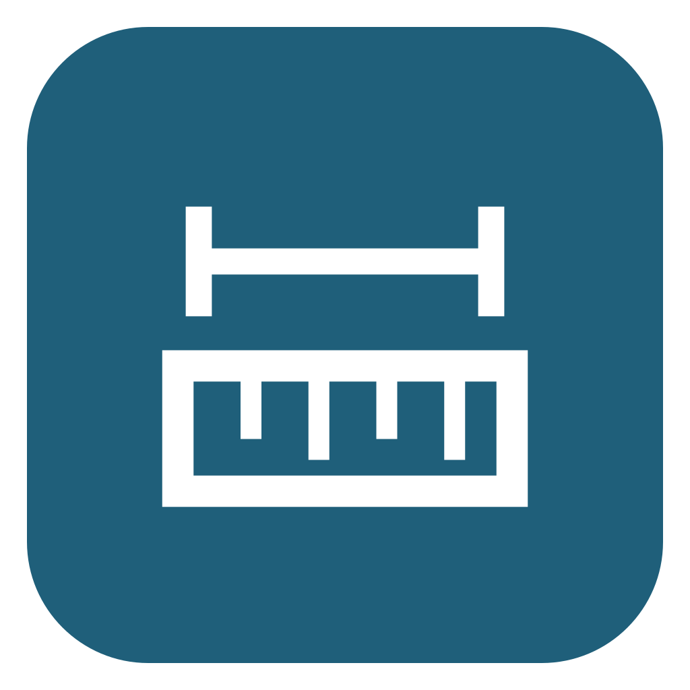
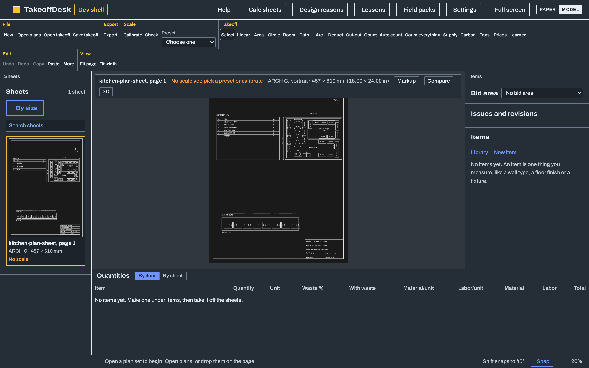

# TakeoffDesk

Measure the drawings. Count the work. Price the job.

TakeoffDesk is a quantity takeoff & estimating app that runs in your browser: calibrated linear, area and count takeoff
from PDF plans and DWG or DXF drawings, with assemblies, cost columns, bid leveling and quantities that export to CSV and
Excel. Your files stay on your computer, and the app contacts no server of its own.



## Run it

You need [Node.js](https://nodejs.org/) 20.19 or newer (22 recommended). No npm packages are installed for the app.

```sh
git clone <this repository>
cd takeoffcraft
npm start                 # then open http://127.0.0.1:8000/
```

The first time a library is needed (pdf.js, three.js, …) it is downloaded once from the npm registry, by exact version,
and checked against `devshell/vendor.json`. `npm run fetch-vendor` downloads them all up front. Behind a company proxy or
a registry mirror, set `NPM_REGISTRY=https://your-mirror/` first.

To put it on a web server for your team, build the browser edition (a folder of static files, see
[BUILDING.md](BUILDING.md#the-browser-edition)).

## Use it with an AI assistant

```sh
npm run mcp               # the same server, also answering AI assistants on this computer
```

Then, in the app, turn on **Settings › TakeoffDesk › Assistants**, and connect Claude Code or Claude Desktop with the token
in `devshell/.mcp-token`. The assistant can read quantities and the estimate, look at sheets, add items and marks (each one
undo step), count legend symbols and measure on DWG/DXF drawings. Setup and details: [devshell/MCP.md](devshell/MCP.md).

## Work on it

```sh
npm test                  # the app's tests
```

`app/` is the app (plain ES modules, CSS and one page of markup), `devshell/` runs, tests and packs it, `tests/` and
`fixtures/` are its tests and sample files. How to contribute: [CONTRIBUTING.md](CONTRIBUTING.md); building from source:
[BUILDING.md](BUILDING.md).

## License

Apache License 2.0 ([LICENSE](LICENSE), [NOTICE](NOTICE)). TakeoffDesk is based on TakeoffCraft by The Data Design Group,
Inc., which does not make or endorse it ([TRADEMARKS.md](TRADEMARKS.md)). Libraries and their licenses:
[THIRD_PARTY.md](THIRD_PARTY.md). Where the code comes from: [PROVENANCE.md](PROVENANCE.md).
